# Manual Técnico - ProyectoUnico

**Universidad de San Carlos de Guatemala**  
**Facultad de Ingeniería - Sistemas Operativos 2**  
**Estudiante: 202203806**

---

## Índice

1. [Introducción](#1-introducción)
2. [Arquitectura del sistema](#2-arquitectura-del-sistema)
3. [Tecnologías utilizadas](#3-tecnologías-utilizadas)
4. [Implementación en Kernel](#4-implementación-en-kernel)
5. [Implementación en Daemon (programa intermedio)](#5-implementación-en-daemon-programa-intermedio)
6. [Implementación del Backend](#6-implementación-del-backend)
7. [Implementación del Frontend](#7-implementación-del-frontend)
8. [Seguridad y control de acceso](#8-seguridad-y-control-de-acceso)
9. [Compilación y ejecución](#9-compilación-y-ejecución)
10. [Pruebas funcionales realizadas](#10-pruebas-funcionales-realizadas)
11. [Conclusiones](#11-conclusiones)
12. [Referencias](#12-referencias)

---

## 1. Introducción

El presente documento detalla la arquitectura, las decisiones de diseño y el proceso de implementación del "Sistema Integral de Monitoreo, Análisis y Respuesta de Seguridad a Nivel Kernel", desarrollado como Proyecto Único para el laboratorio de Sistemas Operativos 2.

A lo largo de este manual, exploraremos cómo logramos comunicar el espacio de Kernel (Kernel space) con el espacio de usuario (User space), utilizando un Daemon concurrente en C como puente hacia una moderna interfaz gráfica interactiva. El objetivo no fue solo cumplir con los requerimientos técnicos, sino construir un sistema robusto, modular y escalable.

La arquitectura está organizada en cuatro capas bien separadas:

- Kernel con syscalls personalizadas.
- Daemon en C para monitoreo, análisis y decisiones.
- Backend HTTP en C para exponer la API.
- Dashboard web para visualización y control por rol.

El flujo principal de datos es:

Kernel (estado y syscalls) -> Daemon (lógica de seguridad) -> Backend (API) -> Frontend (visualización y control).

---

## 2. Arquitectura del sistema

### 2.1 Diagrama general

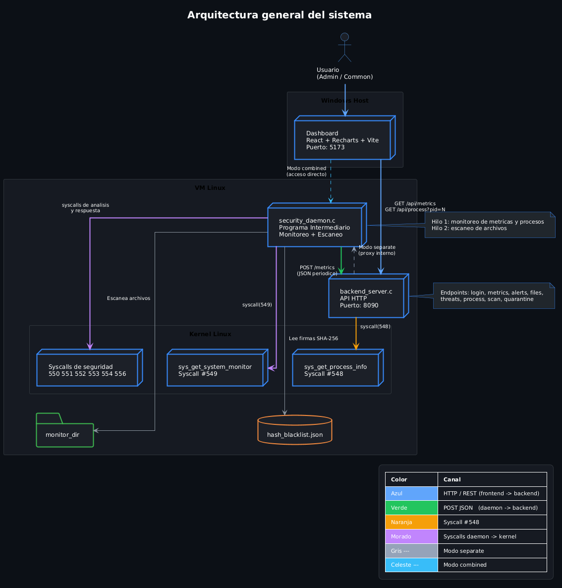

*Figura A. Arquitectura general del sistema (captura exportada del diagrama UML).*

### 2.2 Responsabilidad por componente

| Componente | Ruta principal | Responsabilidad |
| --- | --- | --- |
| Kernel | `ProyectoUnico/Kernel` | Exponer datos crudos y operaciones simuladas mediante syscalls |
| Daemon | `ProyectoUnico/ProgramaIntermedio/src/security_daemon.c` | Monitorear, escanear, clasificar severidad y ejecutar acciones |
| Backend | `ProyectoUnico/ProgramaIntermedio/src/backend_server.c` | Publicar endpoints HTTP para consumo del frontend |
| Frontend | `ProyectoUnico/Dashboard` | Mostrar métricas, alertas, archivos, amenazas y controles |

### 2.3 Modos de despliegue

El despliegue operativo recomendado se realiza con `scripts/run_live.sh`,
que mantiene backend + daemon activos mientras el script esta corriendo y
apaga ambos al presionar `Ctrl+C`.

---

## 3. Tecnologías utilizadas

### 3.1 Kernel

- Lenguaje C.
- Syscalls personalizadas sobre estructura de kernel Linux.

### 3.2 Programa intermedio (Daemon)

- Lenguaje C.
- `pthread` para concurrencia.
- PAM para autenticación real.
- JSON manual sobre HTTP socket.

### 3.3 Backend

- Lenguaje C.
- Servidor HTTP ligero.
- Proxy interno hacia el daemon.

### 3.4 Frontend

- React + Vite.
- Recharts para gráficas.
- CSS personalizado.

## 4. Implementación en Kernel

### 4.1 Syscalls integradas

| No. | Syscall | Uso principal |
| --- | --- | --- |
| 548 | `sys_get_process_info` | Consulta detallada de proceso por PID |
| 549 | `sys_get_system_monitor` | Métricas globales + top procesos |
| 550 | `sys_file_analize` | Hash SHA-256 + metadatos de archivo |
| 551 | `sys_scan_processes` | Lectura de procesos activos (datos crudos) |
| 552 | `sys_quarantine_file` | Marcar archivo en cuarentena simulada |
| 553 | `sys_restore_file` | Restaurar archivo de cuarentena simulada |
| 554 | `sys_get_quarantine_list` | Obtener lista de cuarentena simulada |
| 556 | `sys_simulate_panic` | Registrar evento crítico simulado |

### 4.2 Comportamiento de seguridad en kernel

- No se usa `panic()` real para evitar la caída total de la máquina virtual; en su lugar, se utiliza `pr_err()` para registrar el evento crítico de forma segura en los logs del kernel (`dmesg`).
- La cuarentena es simulada: el kernel mantiene una lista estructurada en memoria (protegida por mutex) con las rutas aisladas, sin mover ni borrar archivos físicamente del disco duro.
- El kernel actúa estrictamente como proveedor de datos y administrador de la lista de bloqueo; la inteligencia y decisión de las severidades reside en el Daemon.

### 4.3 Evidencia de kernel

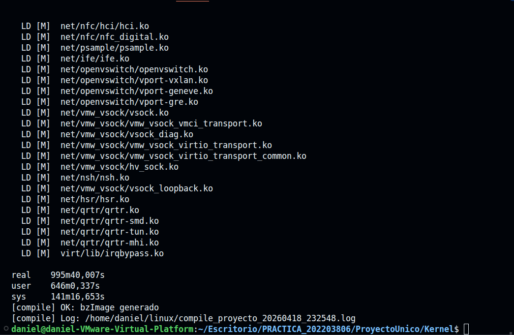

*Figura 1. Compilación del kernel con los cambios del proyecto.*

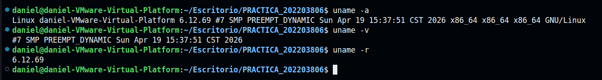

*Figura 2. Arranque del kernel y validación de versión activa.*

---

## 5. Implementación en Daemon (programa intermedio)

Archivo central: `ProyectoUnico/ProgramaIntermedio/src/security_daemon.c`

### 5.1 Concurrencia

Se implementaron dos hilos permanentes:

- Hilo 1: monitoreo de métricas del sistema y procesos
- Hilo 2: escaneo de archivos, cálculo de hash y comparación con blacklist

### 5.2 Lógica de análisis

El daemon realiza:

1. Detección de archivo nuevo o modificado.
2. Comparación del hash con `hash_blacklist.json`.
3. Clasificación de severidad `LOW`, `MEDIUM`, `HIGH`.
4. Registro de alertas y amenazas.
5. Acción según severidad
   - `HIGH`: intenta cuarentena + evento crítico simulado.
   - `MEDIUM/LOW`: alerta y estado sospechoso.

### 5.3 Manejo de errores

Si una syscall falla, el daemon no se cae.  
Usa rutas de respaldo como `/proc`, `stat` y `sha256sum` para mantener continuidad.

### 5.4 Evidencia de daemon

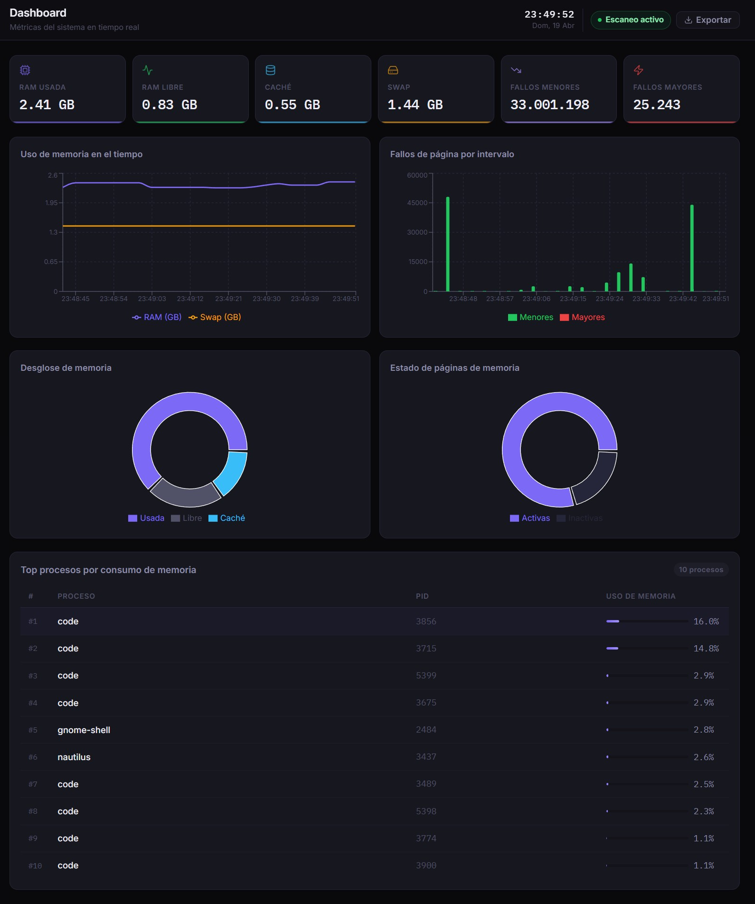

*Figura 3. Daemon en ejecución con monitoreo activo y escaneo controlado.*

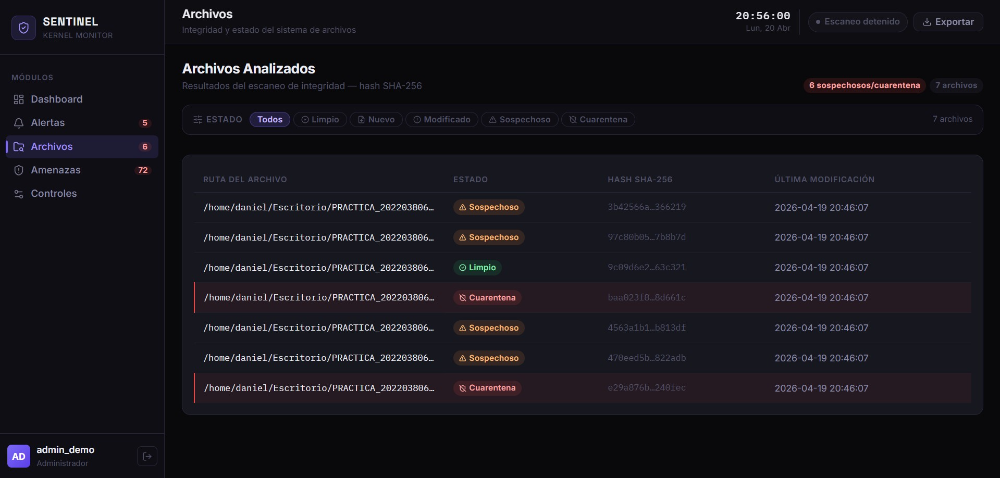

*Figura 4. Detección de amenaza crítica durante escaneo de archivos.*

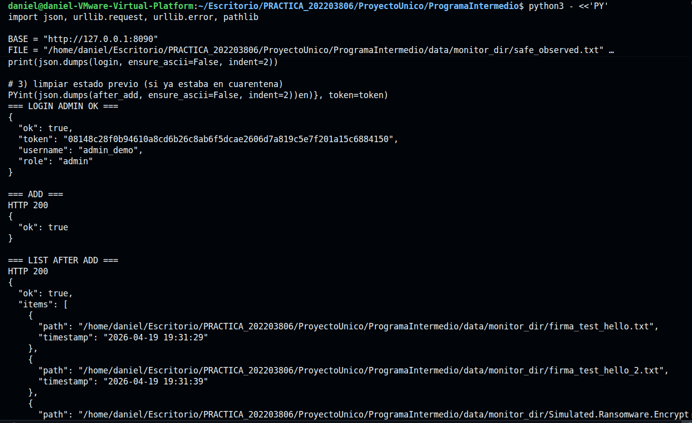

*Figura 5. Operación para agregar archivo a cuarentena.*

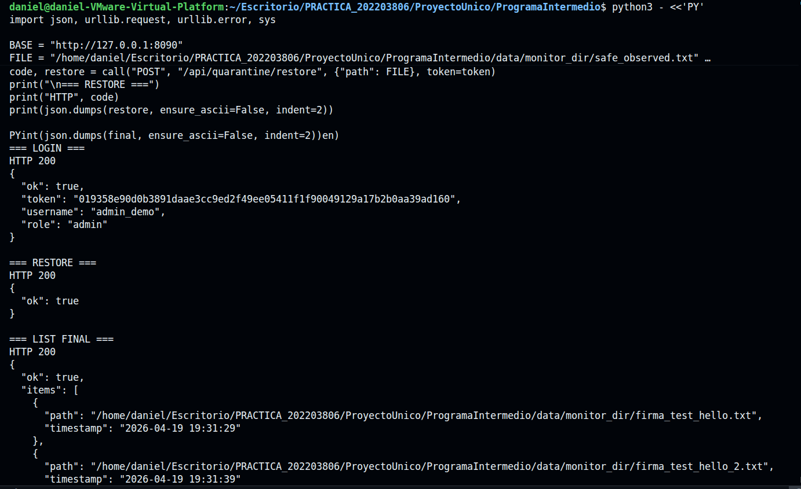

*Figura 6. Restauración manual de archivo desde cuarentena.*

---

## 6. Implementación del Backend

Archivo central: `ProyectoUnico/ProgramaIntermedio/src/backend_server.c`

### 6.1 Función principal

El backend recibe las peticiones del dashboard y las reenvía al daemon.

Se dejó soporte para correr:

- Backend separado del daemon
- Backend combinado con daemon (modo simple)

### 6.2 Endpoints principales

| Método | Ruta |
| --- | --- |
| POST | `/api/login` |
| GET | `/api/me` |
| GET | `/api/metrics` |
| GET | `/api/alerts` |
| GET | `/api/files` |
| GET | `/api/threats` |
| GET | `/api/report/summary` |
| GET | `/api/quarantine` |
| POST | `/api/scan/start` |
| POST | `/api/scan/stop` |
| POST | `/api/scan/once` |
| POST | `/api/quarantine/add` |
| POST | `/api/quarantine/restore` |
| GET | `/api/process?pid=N` |

### 6.3 Permisos

El control se aplica en C, del lado servidor:

- `admin_user`: puede controlar escaneo, consultar PID y gestionar cuarentena.
- `common_user`: solo lectura.

---

## 7. Implementación del Frontend

Ruta: `ProyectoUnico/Dashboard`

### 7.1 Módulos visibles

- Dashboard de métricas.
- Alertas.
- Archivos analizados.
- Amenazas.
- Controles (solo admin).

### 7.2 Comportamiento

- Polling periódico de datos.
- Diferenciación visual por severidad.
- Exportación de reporte JSON.
- Bloqueo de controles sensibles para usuario común.

### 7.3 Evidencia de frontend

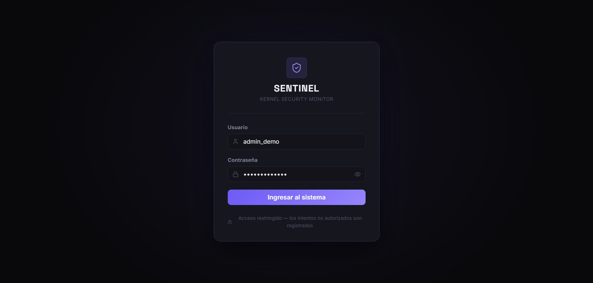

*Figura 7. Inicio de sesión desde interfaz web.*

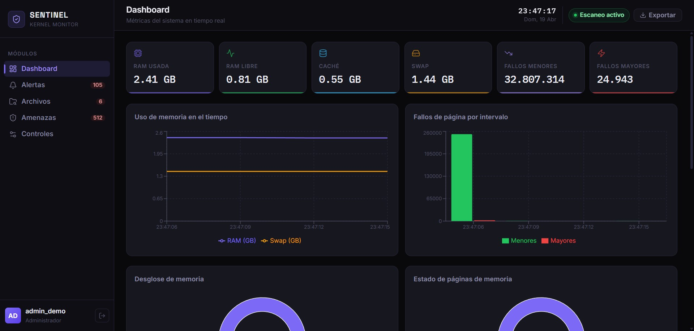

*Figura 8. Vista principal de métricas y navegación por módulos.*

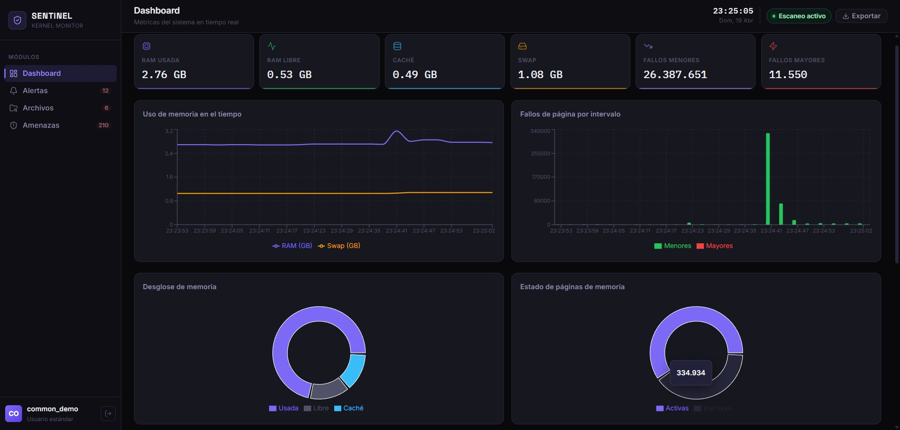

*Figura 9. Restricciones visibles para usuario común.*

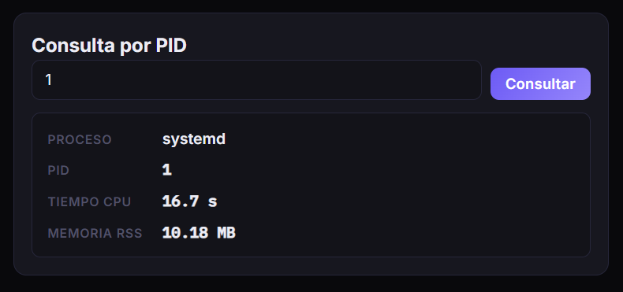

*Figura 10. Consulta de proceso por PID disponible para admin.*

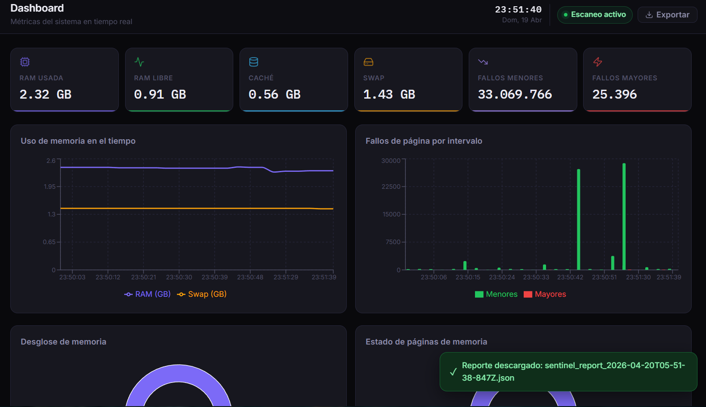

*Figura 11. Exportación de reporte desde el frontend.*

---

## 8. Seguridad y control de acceso

### 8.1 Autenticación

- Login con PAM real.
- Verificación de pertenencia a grupos Linux:
  - `admin_user`
  - `common_user`

### 8.2 Autorización por rol

| Acción | Admin | Common |
| --- | --- | --- |
| Ver métricas/alertas/archivos/amenazas | Sí | Sí |
| Activar/desactivar escaneo | Sí | No |
| Escaneo puntual | Sí | No |
| Listar/agregar/restaurar cuarentena | Sí | No |
| Consulta PID | Sí | No |

---

## 9. Compilación y ejecución

### 9.1 Preparación

```bash
sudo apt update
sudo apt install -y libpam0g-dev nodejs npm
```

Configurar el servicio PAM usado por el daemon:

```bash
sudo cp ProyectoUnico/ProgramaIntermedio/config/security_daemon.pam /etc/pam.d/security_daemon
```

### 9.2 Programa intermedio

```bash
cd ProyectoUnico/ProgramaIntermedio
make
bash scripts/run_live.sh
```

### 9.3 Dashboard

```bash
cd ProyectoUnico/Dashboard
npm install
npm run dev
```

Configuración recomendada en `.env.local`:

```env
VITE_API_BASE=http://IP_DE_LA_VM:8090
VITE_POLL_INTERVAL_MS=3000
```

---

## 10. Pruebas funcionales realizadas

Pruebas que se verificaron durante el desarrollo:

1. Login correcto con usuarios de rol admin y common.
2. Lectura de métricas, alertas, archivos y amenazas.
3. Restricción de endpoints para usuario common.
4. Activación/desactivación de escaneo por admin.
5. Consulta por PID solo para admin.
6. Listado, agregado y restauración de cuarentena solo para admin.
7. Exportación de reporte JSON desde el dashboard.
6. Detección por hash blacklist con severidades.
7. Exportación de reporte JSON.

Evidencia de exportación de archivo:

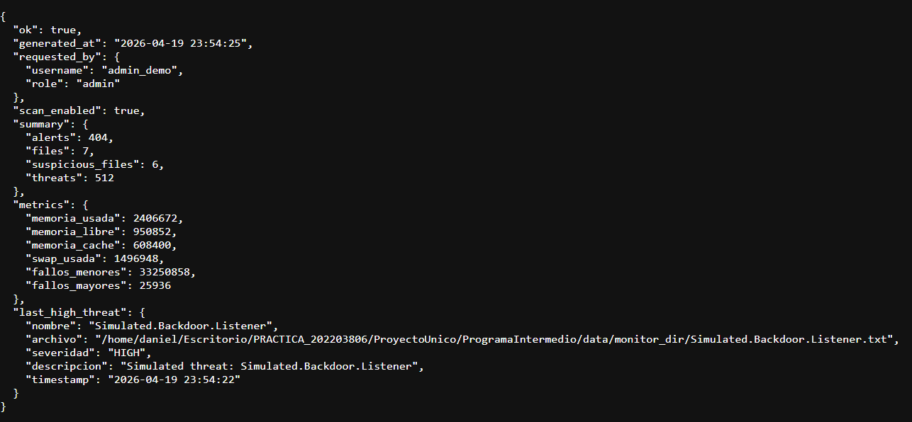

*Figura 12. Archivo JSON exportado como resultado de prueba funcional.*

---

## 11. Conclusiones

Al finalizar el desarrollo de este proyecto, he logrado consolidar conocimientos profundos sobre la arquitectura interna de Linux y el desarrollo de software a bajo nivel, destacando los siguientes puntos clave:

1. **Comunicación Kernel-User:** Se logró integrar con éxito el kernel, un daemon en C, un backend HTTP y un frontend en React, demostrando que es posible crear un flujo de datos bidireccional y estable desde lo más profundo del sistema operativo hasta el navegador web.
2. **Concurrencia Segura:** La implementación de múltiples hilos (`pthreads`) en el Daemon permitió realizar el monitoreo del sistema y el escaneo de archivos de forma simultánea sin bloqueos, manejando correctamente la concurrencia y la sincronización de memoria compartida (mutex).
3. **Seguridad y Control de Acceso:** La delegación de la autenticación a PAM demostró ser una solución robusta y nativa para validar roles en Linux. El control centralizado de los permisos en el backend previene eficazmente cualquier escalamiento de privilegios desde el frontend.
4. **Gestión de Cuarentena Integral:** La lógica implementada para la cuarentena simulada (conectando las syscalls del kernel con los botones interactivos del dashboard) cumple a la perfección con los requerimientos de respuesta manual y automática ante amenazas, sin poner en riesgo la integridad real del File System.

El sistema completo se encuentra operativo y listo para su demostración y defensa técnica.

---

## 12. Referencias

1. Documentación oficial de Linux Kernel: <https://docs.kernel.org>
2. Páginas `man`: `man 2 syscall`, `man 5 proc`, `man pam`
3. Documentación de React: <https://react.dev>
4. Documentación de Vite: <https://vitejs.dev>
5. Documentación de Recharts: <https://recharts.org>
